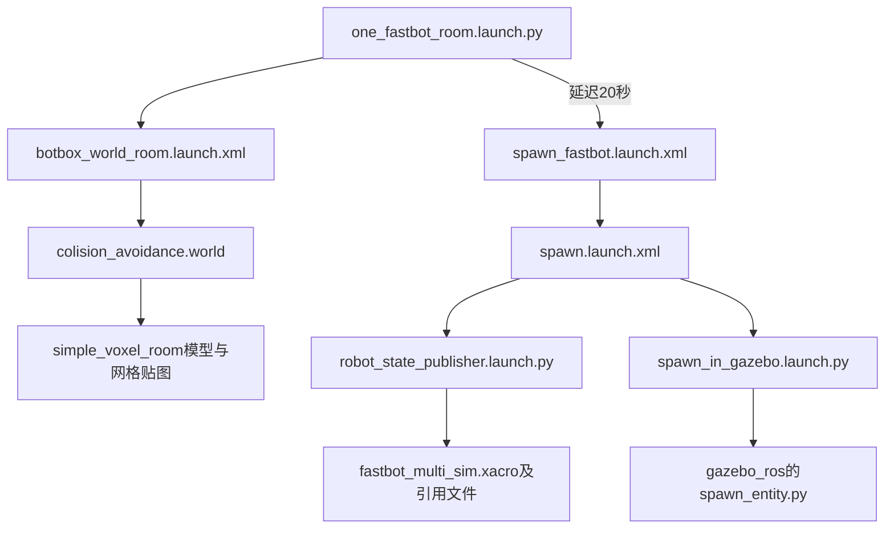

# CP23 课程场景接入核对

2026-11-03，通过本聊天专属浏览器读取用户确认的[CP23 rosject1017054](https://app.theconstruct.ai/desktop/rosject/1017054)。本页为核对摘要，不复制课程全文或代写学习者配置。

## 已确定的真实来源

云端ROS_DISTRO=galactic；源码在/home/user/ros2_ws/src/fastbot，student分支HEAD=9723ef5635f0f9dbb29709d662b772f45c93b979，工作区dirty。故不能只用HEAD代表课程现场全部文件；关键工作副本hash见[资产记录](course_assets.lock.json)。三个启动文件分段读取、重组后SHA256与云端一致。Git状态未修改。

课程原one_fastbot_room.launch.py、实际世界及模型都存在，原来的公开仓库缺口现在有了真实课程参考。现有本地中性房间不再作为默认场景接入路线；共享资源库不变，课程Humble运行仍待验。

## 实际启动关系

世界只include ground_plane和simple_voxel_room，无顶层内嵌机器人model；机器人由spawn链负责，不能复用旧本地world已内嵌FastBot又重复spawn的启动方式。房间模型包含model.config、model.sdf、simple_voxel_room_fix.dae和两张PNG。模型SDF引用相对model://simple_voxel_room/meshes/路径，导入时必须保留目录关系。

世界XML使用Gazebo11，headless默认0，配置GAZEBO_MODEL_PATH到包内models和系统models，加载libgazebo_ros_factory.so、libgazebo_ros_init.so。Xacro引用描述包materials/body及仿真包materials/physics/plugins；插件为相机、差速驱动、ray传感器。这里只核对源文件，不把配置存在当相机/运动/激光实测通过。

## 本地最小接入顺序

1. Coach准备上述两个课程源码包的资产快照与逐文件hash，保留当前工作副本差异；检查范围排除凭据、私人文件及构建输出。不使用云端旧发行版的构建产物作为Humble交付。
2. 准备放入simulation/src/fastbot_description与simulation/src/fastbot_gazebo。当前源码包共有51和81个文件；描述包CMake安装launch/models/onshape，仿真包安装launch/worlds/gazebo/models，导出需保留必需子目录，不能只复制三个launch。
3. 核对Humble镜像中的xacro、robot_state_publisher、colcon和ROS XML/Python launch依赖；当前Gazebo ROS基础安装已有支撑验证。缺失依赖由后续最小学习者配置片段加入，不向WSL宿主安装代替镜像依赖。
4. 再激活学习者COPY/构建配置片段，在镜像中构建这两个包，并准备source overlay后调用ros2 launch fastbot_gazebo one_fastbot_room.launch.py。首次先验证独立服务/接口与停止清理，再验证可见窗口；20秒源定时不是ready证据。
5. 在Task1继续SLAM/Web/Compose，按既有顺序，不提前代写或标PASS。

两个包license仍TODO：本轮完成来源读取，不代表资产分发许可通过。Docker Hub交付前必须核对分发范围。用户批准后已导出并导入119个运行文件，13个非运行文件排除；原源码未改，云端notebook_ws新增一份本聊天导出归档。当前无仿真启动，CP23-C003已生成且COPY留空。

首次建议提交点仍为实际工程可复现的Gazebo基础片段与同步说明，届时先通知用户审阅，当前不commit/push。