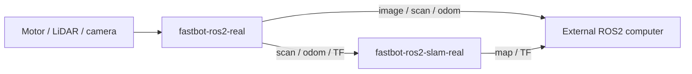

# Task2 — FastBot 真机容器

目标为 Ubuntu22.04 / ROS2 Humble / linux/arm64。real/src 是 CP21 真机源码的固定快照，revision 与文件 SHA256 见 source.lock.json。机器人模型沿用 CP21 的近似模型，传感器外参尚未重新标定。

两个服务分别运行摄像头、N10雷达、电机驱动，以及 Cartographer SLAM。SLAM 使用真实时间，订阅 /fastbot/scan 和 /fastbot/odom，发布 /map。Compose 使用 host 网络，便于容器之间以及外部 ROS2 电脑直接通信。



先在 real/.env 中填写本机设备和镜像来源。串口使用 /dev/serial/by-id 中的实际路径，两个串口分别映射为容器内 /dev/fastbot_motor 和 /dev/fastbot_lidar。CAMERA_DEVICE 默认 /dev/video0。应用以 UID1000 运行，设备附加组为 dialout20、video44。

```dotenv
CP23_RUN_ID=your-run-id
ROS_BASE=ros:humble-ros-base-jammy@sha256:verified-digest
ROS_DOMAIN_ID=0
MOTOR_DEVICE=/dev/serial/by-id/your-motor-adapter
LIDAR_DEVICE=/dev/serial/by-id/your-lidar-adapter
CAMERA_DEVICE=/dev/video0
```

首次本地构建在 real 目录运行以下命令，ROS_BASE 应先拉取并核对 ARM64 架构与 digest。

```bash
docker compose build
docker compose up -d
docker compose ps
docker compose logs --tail 50
```

正常发布后可直接拉取本项目 Docker Hub 的两个标签。

```bash
docker compose pull
docker compose up -d --no-build
```

restart: unless-stopped 配合 Docker 已启用的开机服务，负责上电恢复。首次验收须在容器运行状态下真正关机、重新上电，再检查新的 boot_id、两个容器及实际传感器/地图数据。手动停止的容器需要重新 up -d，才会恢复自动启动状态。

镜像内可通过入口脚本准备 ROS 环境后检查真实话题。

```bash
docker compose exec fastbot-ros2-real /usr/local/bin/fastbot_entrypoint.sh ros2 topic list
docker compose exec fastbot-ros2-slam-real /usr/local/bin/fastbot_entrypoint.sh ros2 topic info /map
```

外部电脑需要相同 ROS_DOMAIN_ID、可互通的 DDS 网络以及 RViz2。在外部电脑运行 ros2 topic list，并在 RViz2 中将 Fixed Frame 设为 map、添加 /map 显示。外部验收应观察实际数据，不能以机器人内部命令替代。

2026-11-09：两镜像已在Pi原生ARM64构建，首批雷达时间戳修复、真实传感器/SLAM及本机WSL RViz2/录包均已验证。实际关机断电后重新上电、自动启动和WSL实时数据恢复均已验证；两个ARM镜像已发布并从远端拉取核对digest，固定信息见release.lock.json。精确结果写入本项目训练笔记 verification.md 与 runtime_logs/task2_20261109。


## 本机 WSL 外部查看（已验证）

Windows/WSL NAT会影响跨设备DDS发现。本项目保留两个应用容器，另用官方Zenoh通信桥连接Pi的ROS域0和WSL的ROS域194。桥转发真实ROS数据；云端不参与此项验收。两个域必须不同，避免直接DDS和桥重复传播。同一桥也能传递ROS命令，只在准备运动时启动控制端。

Pi端在real目录启动辅助桥，应用无需重启：

```bash
docker compose --env-file .env -f compose.wsl-link.yaml up -d
```

辅助镜像为eclipse/zenoh-bridge-ros2dds:1.10.1，固定上游多架构digest及实际导出映射见network.lock.json。桥不接触设备，非root只读运行，监听当前可信局域网TCP17447；独立于课程两个应用镜像，无需发布到你的仓库。

WSL Ubuntu-22.04需安装ROS2 Humble、RViz2及ros-humble-rmw-cyclonedds-cpp。进入工程根目录后：

```bash
docker pull --platform linux/amd64 eclipse/zenoh-bridge-ros2dds@sha256:74fae6a9d4f449c53d1ee6f0faaca97d01c1e68dfcafd785b657f01907157d22
python3 real/wsl_viewer.py prepare
python3 real/wsl_viewer.py version
source /opt/ros/humble/setup.bash
python3 real/wsl_viewer.py run --robot 192.168.1.73
```

prepare从固定官方镜像提取二进制与运行库，逐个核对SHA256，仅放入runtime_logs/wsl_bridge，不全局安装musl。run设置进程局部环境并启动RViz2；关闭RViz后停止其自建桥。本次验收的专用桥/窗口由运行记录管理，勿同时再开第二套run。

查看器运行期间，另一个WSL终端：

```bash
source /opt/ros/humble/setup.bash
export ROS_DOMAIN_ID=194 ROS_LOCALHOST_ONLY=0 RMW_IMPLEMENTATION=rmw_cyclonedds_cpp
ros2 topic list --no-daemon
python3 real/check_runtime.py
```

本次实际显示Global Status: Ok、实时地图和激光。12秒录包含scan118/odom117/map13/tf2479/tf_static1。地图仅是当前传感器实际可见区域，不代表整个场地已探索完成。硬件模型仍为CP21近似外参，未重新标定。

## 源码取得

本项目Git历史目前仍保存在本地，尚未配置Git远端。之后将源码推送到自己的仓库后，可使用git clone <你的源码仓库URL> ~/ros2_ws/src/fastbot_ros2_docker，再进入real目录并运行python3 prepare_env.py生成本机.env。不要提交.env、SSH密钥或runtime_logs。当前Pi部署与WSL源码已对应到source.lock.json；Docker Hub用于分发镜像，不代替Git源码仓库。
